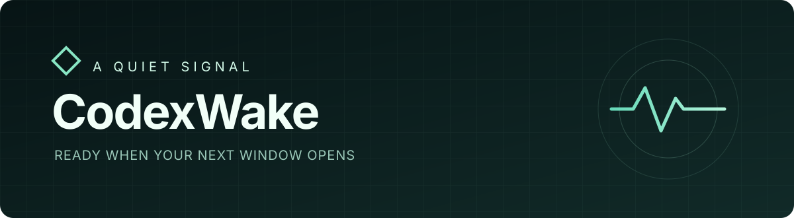
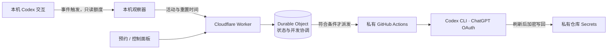

<div align="center">



# CodexWake

### 让下一段专注时间，提前准备好。

面向个人使用的 Codex 窗口调度器。<br>
本机记录真实活动，云端等待合适时机，私有 Runner 完成一次轻量请求。

[](LICENSE)


[部署指南](docs/DEPLOYMENT.md) · [操作手册](docs/OPERATIONS.md) · [GPL-3.0](LICENSE)

</div>

---

CodexWake 是一个自托管实验项目。它监听本机 Codex 的真实交互，在满足额度与时间条件时，让云端私有 GitHub Actions 使用 ChatGPT OAuth 发送一条简短消息。预约可以提前安排下一次使用时间；Mac 离线后，已经上报的计划仍由云端处理。

> **当前状态**：自动发送默认关闭。真实窗口是否被启动需要结合账号额度观察；CLI 成功退出本身不代表已证实窗口启动。不同客户端、订阅方案及未来的 Codex CLI 版本可能有不同表现。

## 工作方式



- **按活动布防**。本机出现匹配的一轮用户交互后读取额度并上报；Codex 空闲时没有本机定时探测。
- **有限滚动与预约**。活动后的连续唤醒默认最多两次，可调整；预约可选时长、重复方式和目标恢复时间。
- **自定义时段**。支持时区、允许时间、睡眠时段和暂停；睡眠期间推迟执行。
- **双面板**。macOS 本机面板可按需启动，手机面板可部署到独立 Worker 并用 Cloudflare Access 保护。
- **凭证与状态协调**。使用独立 OAuth 登录、GitHub OIDC、加密的 Actions Secret、并发组和一次性执行许可。结果不明确时停止继续发送。

五小时重置时间以本机读取到的额度为依据。后续滚动依照执行时间保守估算，其他设备的使用以及平台内部变化可能造成偏差。模型来自当前账号在锁定版 Codex CLI 中的可用列表，需要使用者选择。

## 开始使用

需要 Node.js 24 或更新版本、Cloudflare 账号、GitHub 账号、macOS，以及支持 ChatGPT 登录的 Codex 订阅。云端执行必须使用**自己的私有 GitHub 仓库**，公开源码仓库不能作为 OAuth 凭证的执行环境。

```sh
npm ci
npm test
npm run check
```

测试和 Worker 打包检查使用占位配置，不会发送模型消息。部署需要创建自己的 Worker、KV 和两个最小权限令牌，并配置独立的私有执行仓库。完整步骤见 [部署指南](docs/DEPLOYMENT.md)。

部署完成后，可以安装 macOS 按需面板：

```sh
npm run dashboard:install
```

在浏览器打开 `http://127.0.0.1:8787`。面板在访问时启动，空闲后退出。远程手机面板需要额外配置 Cloudflare Access，步骤见[操作手册](docs/OPERATIONS.md)。

## 使用边界

- Codex、Cloudflare 和 GitHub 的额度及规则可能变化。免费层额度由账号内的其他项目共享，服务不能承诺所有情况下零费用。
- 本机观察器只知道已上报的活动，无法实时感知其他设备的所有请求。实际运行前请了解调度逻辑及可能的重复唤醒。
- 开源代码和运行凭证分开管理。不要把 `auth.json`、令牌、Worker 地址配置或私人日志提交到公开仓库。
- 此项目与 OpenAI、Cloudflare、GitHub 均无官方关联。请遵守各服务当前适用的使用条款。

## 开发

```sh
npm test                       # 单元与本地集成测试
npm run check                  # 主 Worker 打包检查
npm run dashboard:cloud:check  # 手机面板打包检查
```

项目采用 [GNU General Public License v3.0](LICENSE)。第三方依赖遵循各自的许可证。
